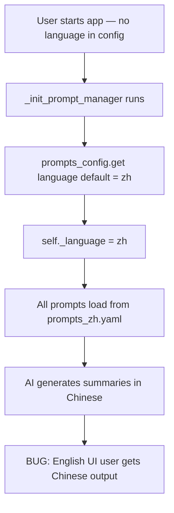
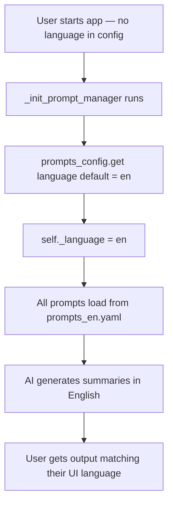
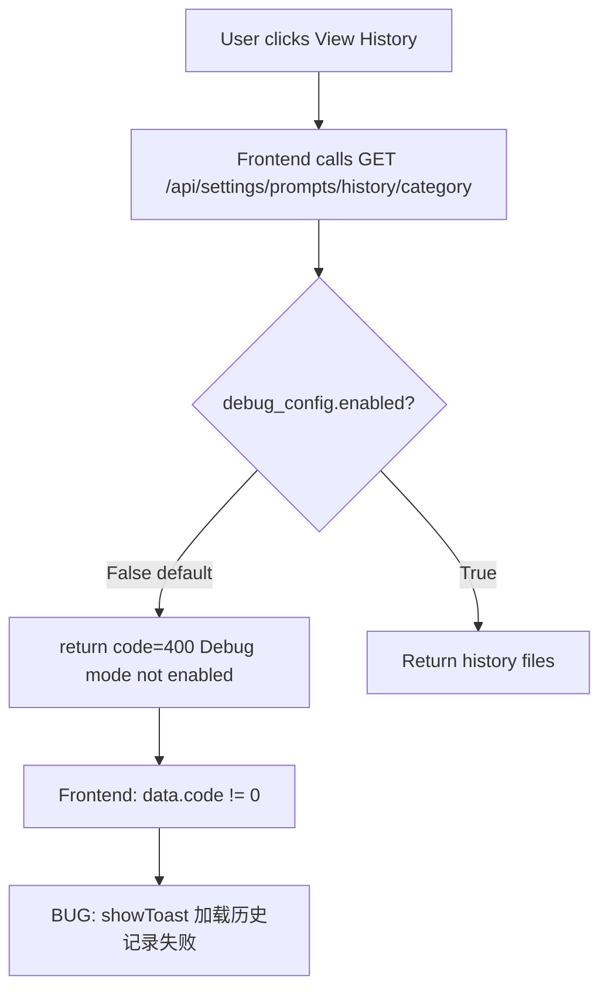
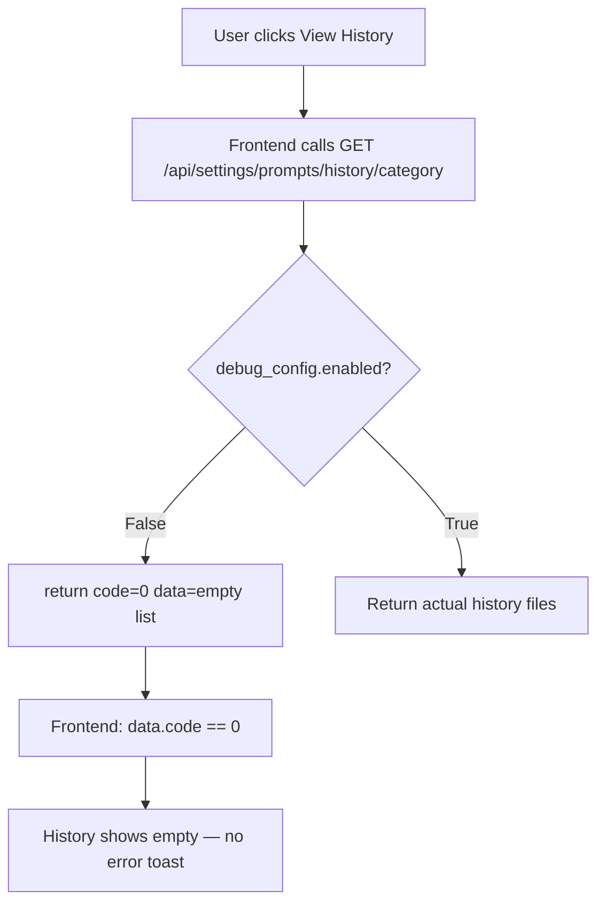

# Fix: Default Prompt Language and Prompts History Endpoint

## Bug 1 — Summaries Always Generated in Chinese

### Summary
All AI-generated summaries came out in Chinese regardless of the UI language or prompt settings, because the default language was hardcoded to `"zh"` in two places.

### Root Cause
`global_config.py` has two fallback paths that both default to Chinese:
1. `_init_prompt_manager` uses `prompts_config.get("language", "zh")`
2. `get_language()` returns `"zh"` if `_language` was never set

Any user without an explicit `language` key in their config — which is the case for most users — always got Chinese output.

### Bug Flow

### Fix Flow

---

## Bug 2 — "Load History Failed" Toast After Saving Prompts

### Summary
Every user saw an error toast when viewing prompt history because the endpoint returned `code=400` when debug mode was disabled — which is the default state.

### Root Cause
The `/api/settings/prompts/history/{category}` endpoint checked debug mode and returned a 400 error if it was off. The frontend treats any non-zero code as an error and shows "加载历史记录失败".

### Bug Flow

### Fix Flow

## Files Changed

| File | Change |
|------|--------|
| `opencontext/config/global_config.py` | Two `"zh"` defaults changed to `"en"` |
| `opencontext/server/routes/settings.py` | `code=400` response changed to `data=[]` with code 0 |

## PR Description

**Title:** `fix(config,settings): default prompt language to English and fix history endpoint`

**Fixes #175, #273, #183**

The prompt language defaulted to "zh" in two places in global_config.py, causing all summaries to be generated in Chinese regardless of UI language or user preference. Changed both defaults to "en".

The prompts history endpoint returned code=400 when debug mode was disabled, which the frontend treated as an error and showed "加载历史记录失败". Changed to return an empty list with code=0, matching the behaviour when the history directory does not exist.
