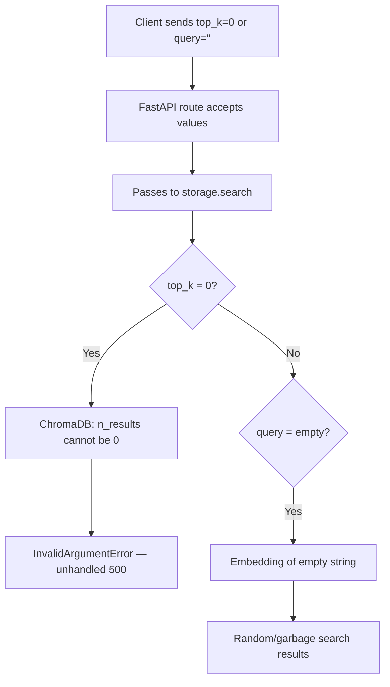
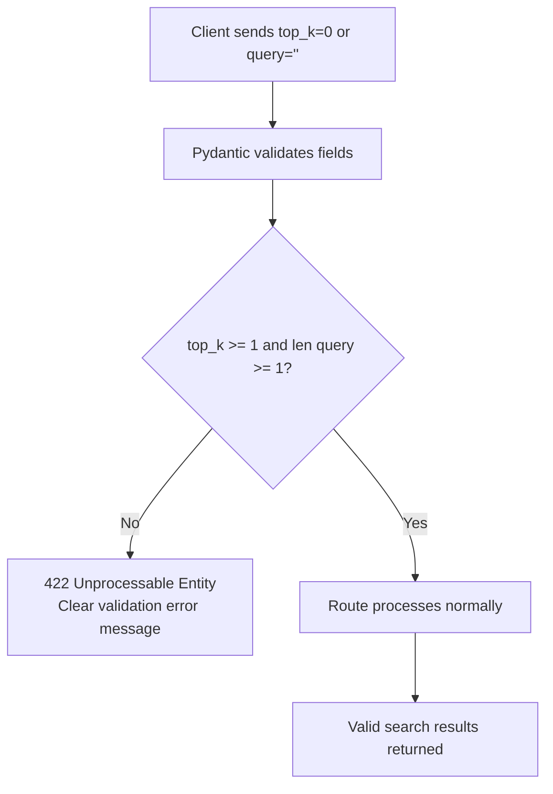
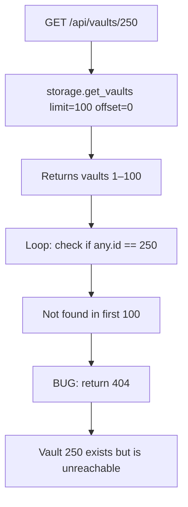
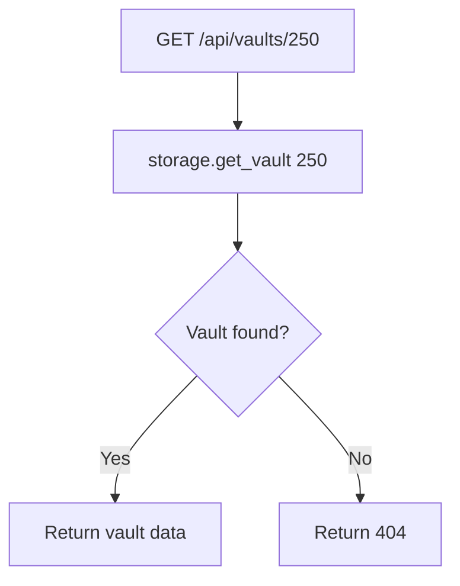

# Fix: API Input Validation and Vault Lookup

## Bug 1 — top_k=0 and Empty Query Crash Vector Search

### Summary
Sending `top_k=0` or an empty `query` to vector search endpoints caused unhandled errors deep in the storage layer with no useful error message returned to the client.

### Root Cause
No Pydantic validation existed on these fields. ChromaDB raises `InvalidArgumentError` when `n_results=0`. An empty string query generated a zero-vector embedding that returned random results.

### Bug Flow

### Fix Flow

---

## Bug 2 — Vault Lookup Only Scanned First 100 Records

### Summary
`GET /api/vaults/{id}` returned 404 for vaults beyond position 100, even when the vault existed.

### Root Cause
The handler fetched `get_vaults(limit=100, offset=0)` and iterated looking for the ID. Any vault stored after the first 100 was unreachable via this endpoint.

### Bug Flow

### Fix Flow

---

## Bug 3 — Vault List Has No Upper Bound

`GET /api/vaults/list?limit=1000000` accepted any integer, potentially loading the entire database into memory.

**Fix:** Added `le=1000` to the limit query parameter.

## Files Changed

| File | Change |
|------|--------|
| `opencontext/server/routes/context.py` | Added `ge=1` on top_k, `min_length=1` on query |
| `opencontext/server/routes/vaults.py` | Direct `get_vault(id)` call; `le=1000` on list limit |

## PR Description

**Title:** `fix(api): add input validation and fix vault document lookup`

top_k=0 caused ChromaDB to raise InvalidArgumentError. An empty query string produced garbage results. Added ge=1 on top_k and min_length=1 on query fields.

GET /api/vaults/{id} iterated through the first 100 vaults and returned 404 for any vault beyond that window. Replaced with a direct storage.get_vault(id) call.

GET /api/vaults/list accepted any integer for limit with no upper bound. Added le=1000 to prevent OOM on large installs.
