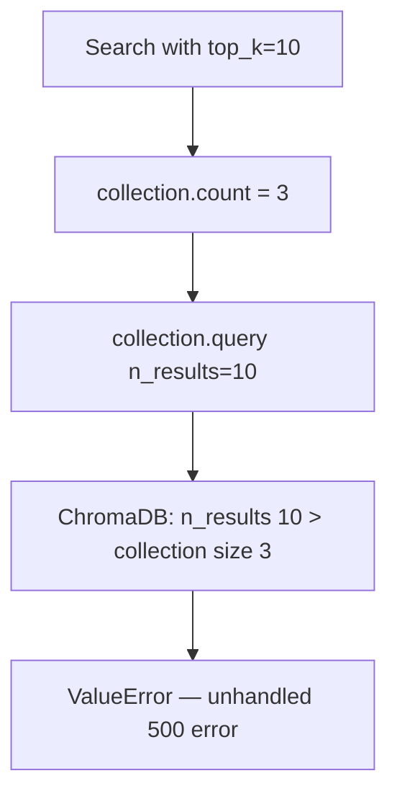
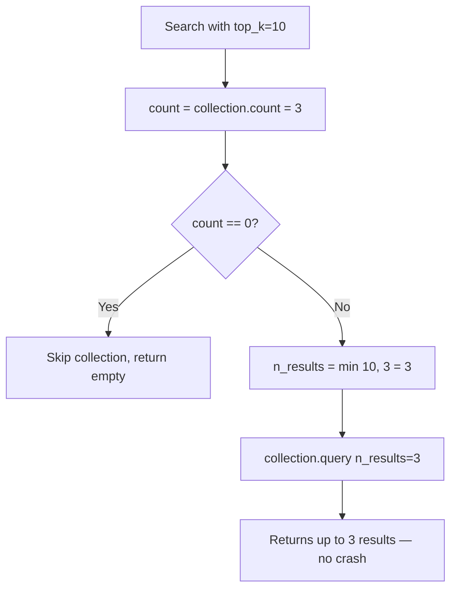
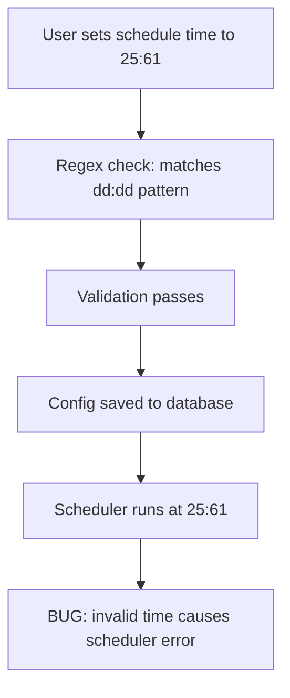
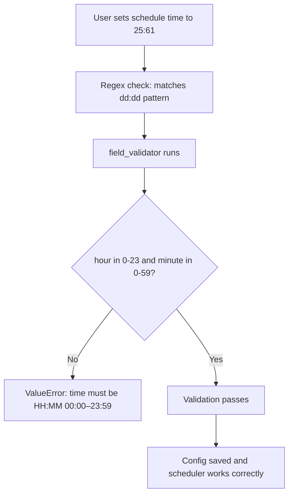

# Fix: ChromaDB Result Count Clamp and Report Time Validation

## Bug 1 — ChromaDB Crashes When top_k Exceeds Collection Size

### Summary
Vector search failed with an unhandled `ValueError` whenever `top_k` was larger than the number of items in a collection — a common situation on new installs or small datasets.

### Root Cause
`collection.query(n_results=top_k)` was called without checking the current collection size. ChromaDB requires `n_results <= collection.count()`.

### Bug Flow

### Fix Flow

---

## Bug 2 — Report Schedule Accepts Invalid Times Like "25:61"

### Summary
The scheduler accepted times like `"25:61"` as valid, leading to errors at execution time rather than at configuration time.

### Root Cause
`ReportConfig.time` used the regex `^\d{2}:\d{2}$` which validated format but not value range.

### Bug Flow

### Fix Flow

## Files Changed

| File | Change |
|------|--------|
| `opencontext/storage/backends/chromadb_backend.py` | `n_results=min(top_k, count)` before collection.query |
| `opencontext/server/routes/content_generation.py` | Added `field_validator` for hour/minute range check |

## PR Description

**Title:** `fix(storage,api): clamp ChromaDB result count and validate report schedule time`

ChromaDB raises ValueError when n_results exceeds the collection item count. Applied min(top_k, count) before querying, matching the pattern already used in search_similar_todos().

ReportConfig.time accepted invalid times like "25:61" that passed the regex but caused scheduler errors. Added a field_validator to check hour 0-23 and minute 0-59.
