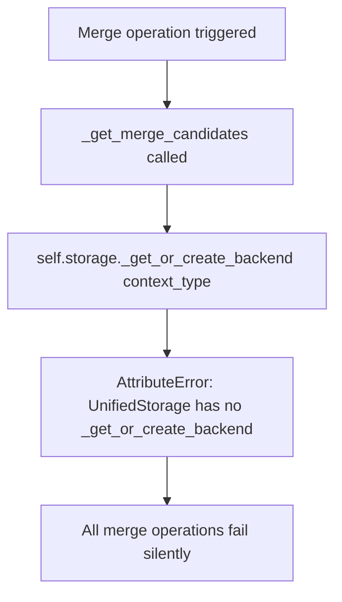
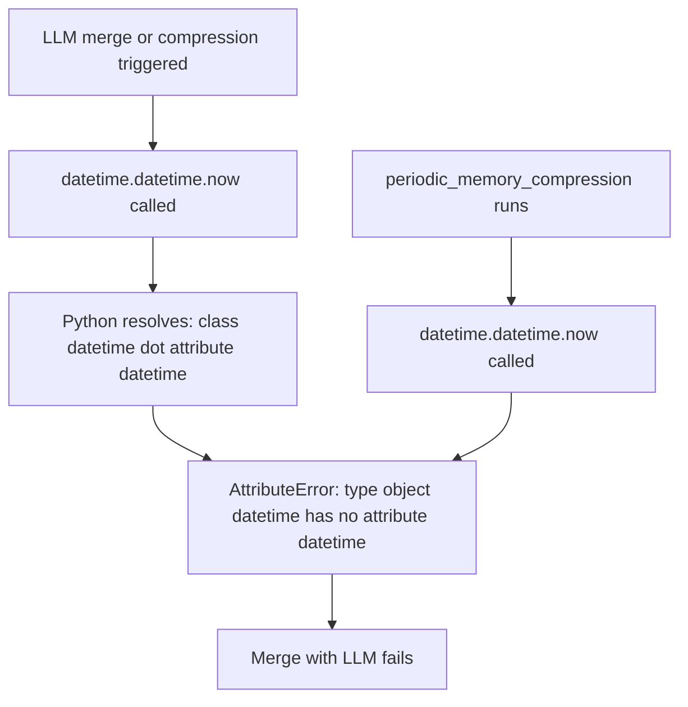
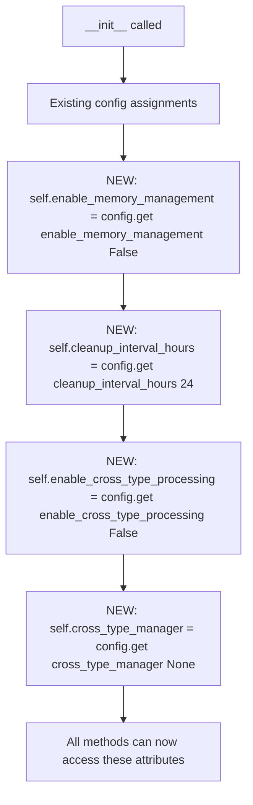

# Fix: Broken Context Merger Subsystem

## Overview

The entire context merging subsystem was non-functional due to four overlapping bugs in `context_merger.py`. Any attempt to merge or compress contexts raised `AttributeError` before performing any work.

---

## Bug 1 — Non-Existent Method `_get_or_create_backend`

### Root Cause
All merge candidate lookups called `self.storage._get_or_create_backend(context_type)`. `UnifiedStorage` has no such method. This raised `AttributeError` on every merge operation.

### Bug Flow

### Fix
Replaced the backend lookup + `backend.query()` pattern with `self.storage.search(...)` — the correct public API.

---

## Bug 2 — Wrong Method Name `backend.query()` Instead of `backend.search()`

### Root Cause
After the (failed) backend lookup, code called `backend.query(...)`. Neither `ChromaDBBackend` nor `QdrantBackend` exposes a `query()` method — both use `search()`.

Combined with Bug 1, this was a double `AttributeError` — the backend was never obtained and the wrong method was called on it.

---

## Bug 3 — `datetime.datetime.now()` AttributeError

### Root Cause
The file imports `from datetime import datetime`, making `datetime` the class itself. Five call sites then used `datetime.datetime.now()` — trying to access an attribute named `datetime` on the class object.

### Bug Flow

### Fix
Replaced all `datetime.datetime.now()` → `datetime.now()` and `datetime.datetime.fromisoformat(x)` → `datetime.fromisoformat(x)`.

---

## Bug 4 — Undefined Instance Attributes

### Root Cause
Methods referenced `self.enable_memory_management`, `self.cleanup_interval_hours`, `self.enable_cross_type_processing`, and `self.cross_type_manager` but `__init__` never assigned them. Any call to memory management or cross-type methods raised `AttributeError`.

### Fix Flow

## Files Changed

| File | Change |
|------|--------|
| `opencontext/context_processing/merger/context_merger.py` | Fixed non-existent method calls, wrong method name, datetime usage, missing __init__ attributes |

## PR Description

**Title:** `fix(merger): repair broken context merger subsystem`

The context merger called a non-existent _get_or_create_backend() method on UnifiedStorage and then called .query() on the result — neither method exists. Replaced both with the correct public storage search API.

Five call sites used datetime.datetime.now()/fromisoformat() after importing datetime as the class directly, causing AttributeError on every merge and compression run.

Added missing __init__ assignments for enable_memory_management, cleanup_interval_hours, enable_cross_type_processing, and cross_type_manager which caused AttributeError on any memory management or cross-type call.
