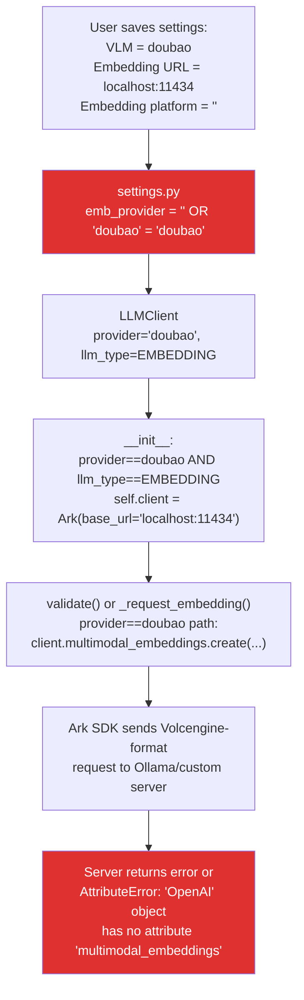
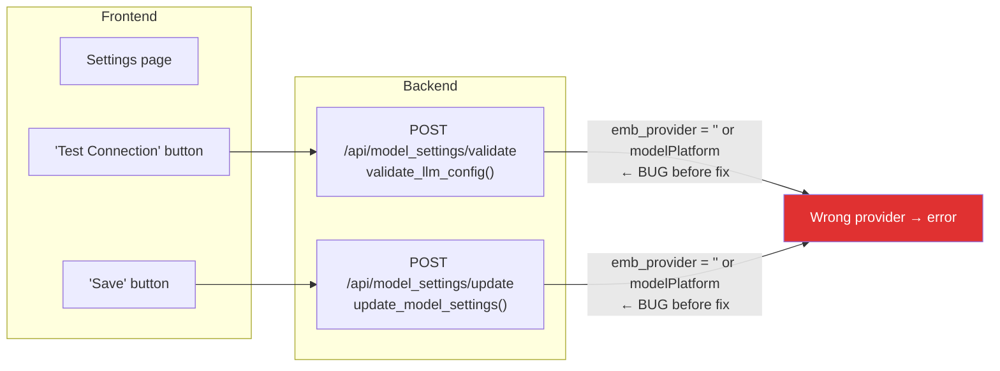
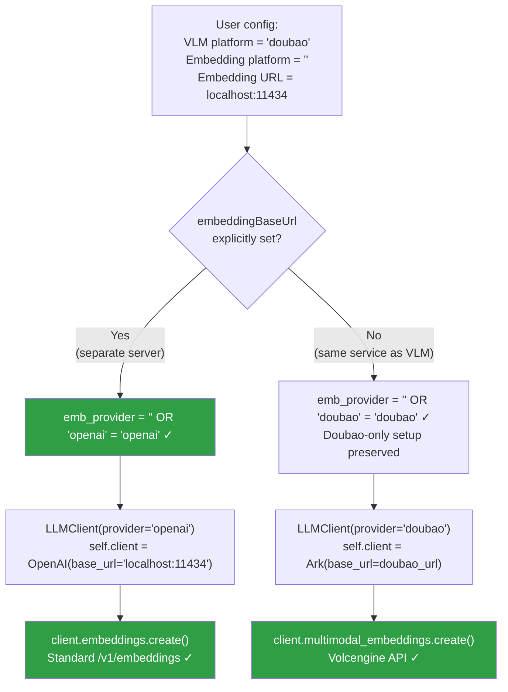

# Embedding Provider Inheritance Fix — Issues #355 #346 #351

## PR Description

**Title:** `fix(settings): don't inherit VLM provider for separate embedding endpoint`

**Branch:** `varun-projects:fix/embedding-provider-v2` → `volcengine/MineContext:main`

---

### What's happening

When a user configures a **Doubao VLM** alongside a **separate custom
OpenAI-compatible embedding server** (Ollama, LM Studio, a local BGE server,
etc.), embedding validation always fails:

```
AttributeError: 'OpenAI' object has no attribute 'multimodal_embeddings'
```

or the custom server returns a 500 because it received a Volcengine-format
request instead of a standard `/v1/embeddings` call.

### Root cause

In `opencontext/server/routes/settings.py`, when `embeddingModelPlatform` is
not explicitly set, the code inherits the VLM platform:

```python
emb_provider = cfg.embeddingModelPlatform or cfg.modelPlatform
```

If the VLM platform is `"doubao"`, the embedding `LLMClient` is initialised
with the Ark SDK and calls `multimodal_embeddings()` against the user's custom
server — which only implements standard `/v1/embeddings`.

The same bug existed in **two endpoints**: the save route
(`/api/model_settings/update`) and the live validation route
(`/api/model_settings/validate`, the "Test Connection" button).

### Fix

When `embeddingBaseUrl` is explicitly set (pointing at a different host), default
the embedding provider to `"openai"` instead of inheriting `modelPlatform`:

```python
if cfg.embeddingBaseUrl:
    emb_provider = cfg.embeddingModelPlatform or LLMProvider.OPENAI.value
else:
    emb_provider = cfg.embeddingModelPlatform or cfg.modelPlatform
```

Applied to both endpoints. Doubao-only setups (no separate embedding URL) are
unchanged.

### Scope

One-file change in `opencontext/server/routes/settings.py` — two small blocks,
one in `update_model_settings` and one in `validate_llm_config`.

### Affected configurations

| Setup | Before | After |
|---|---|---|
| Doubao VLM + Doubao embedding (same URL) | ✅ works | ✅ works (unchanged) |
| Doubao VLM + custom embedding (separate URL) | ❌ `multimodal_embeddings` error | ✅ standard `/v1/embeddings` |
| Custom VLM + custom embedding (same URL) | ✅ works | ✅ works (unchanged) |
| Custom VLM + custom embedding (separate URL) | ✅ works | ✅ works (unchanged) |

Fixes #355, #346, #351

---

## Technical Documentation

### Provider routing architecture

MineContext supports two embedding backends depending on the `provider` field:

```
provider = "doubao"
    ↓
LLMClient.__init__
    self.client = Ark(...)          ← Volcengine SDK
    _request_embedding → client.multimodal_embeddings.create(...)

provider = "openai" (or any other)
    ↓
LLMClient.__init__
    self.client = OpenAI(...)       ← OpenAI Python SDK
    _request_embedding → client.embeddings.create(...)
```

The wrong SDK + wrong API combination produces `AttributeError: 'OpenAI' object
has no attribute 'multimodal_embeddings'`.

---

### The Bug

#### How provider gets set incorrectly

```
User config sent from frontend:
  modelPlatform          = "doubao"    ← VLM uses Volcengine
  embeddingModelPlatform = ""          ← left blank (common — UI may not show this)
  embeddingBaseUrl       = "http://localhost:11434/v1"  ← separate Ollama server

settings.py resolves:
  emb_provider = cfg.embeddingModelPlatform or cfg.modelPlatform
               = ""  or  "doubao"
               = "doubao"   ← BUG: inherits VLM provider
```

#### Bug flowchart — save / validate flow



#### Both endpoints affected



---

### The Fix

#### Fix flowchart — correct provider resolution



---

### Code change

**File:** `opencontext/server/routes/settings.py`

#### Import

```python
# Before
from opencontext.llm.llm_client import LLMClient, LLMType

# After
from opencontext.llm.llm_client import LLMClient, LLMProvider, LLMType
```

#### `update_model_settings` (line ~119)

```python
# Before
emb_url = cfg.embeddingBaseUrl or cfg.baseUrl
emb_provider = cfg.embeddingModelPlatform or cfg.modelPlatform

# After
emb_url = cfg.embeddingBaseUrl or cfg.baseUrl
if cfg.embeddingBaseUrl:
    emb_provider = cfg.embeddingModelPlatform or LLMProvider.OPENAI.value
else:
    emb_provider = cfg.embeddingModelPlatform or cfg.modelPlatform
```

#### `validate_llm_config` (line ~216)

```python
# Before
emb_url = cfg.embeddingBaseUrl or cfg.baseUrl
emb_provider = cfg.embeddingModelPlatform or cfg.modelPlatform

# After
emb_url = cfg.embeddingBaseUrl or cfg.baseUrl
if cfg.embeddingBaseUrl:
    emb_provider = cfg.embeddingModelPlatform or LLMProvider.OPENAI.value
else:
    emb_provider = cfg.embeddingModelPlatform or cfg.modelPlatform
```

---

### Design decisions

| Decision | Rationale |
|---|---|
| Key on `embeddingBaseUrl` presence | Explicit separate URL is the clearest signal the user intends a different service |
| Default to `LLMProvider.OPENAI.value` | Standard OpenAI-compatible API; works for Ollama, LM Studio, vLLM, custom servers |
| Preserve `or modelPlatform` for same URL | Doubao users pointing VLM and embedding at the same Ark endpoint need no changes |
| Fix both endpoints | `validate_llm_config` powers the "Test Connection" button — fixing only `update` would leave a confusing UX where Test fails but Save eventually works (or vice versa) |

---

### Files changed

| File | Lines changed | What |
|---|---|---|
| `opencontext/server/routes/settings.py` | ~10 | Import `LLMProvider`; URL-aware provider resolution in both endpoints |
