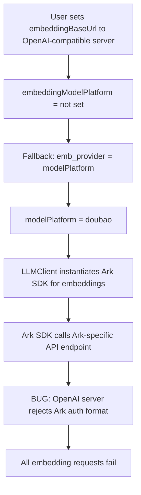
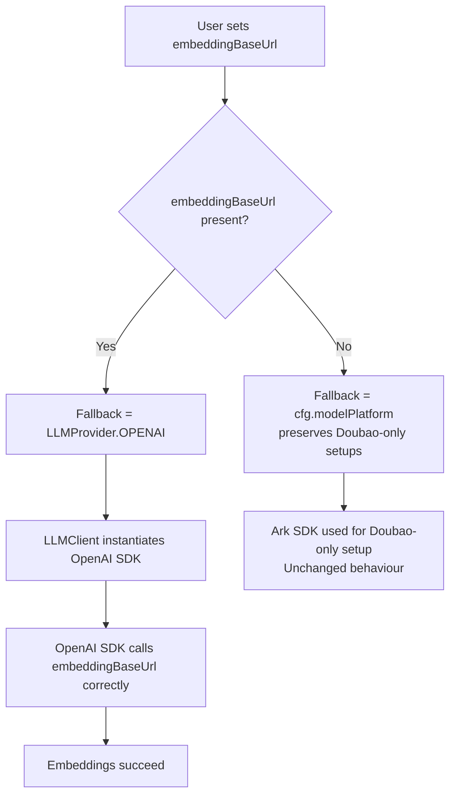

# Fix: Embedding Provider Inheritance

## Bug Summary

When configuring a separate embedding server (`embeddingBaseUrl`) alongside a Doubao/Ark main LLM, all embedding requests failed because the Ark SDK was used to call an OpenAI-compatible endpoint.

## Root Cause

The provider fallback logic was `emb_provider = cfg.embeddingModelPlatform or cfg.modelPlatform`. When no explicit embedding provider was set, it inherited the main LLM provider (Doubao). The Ark SDK was then used against an OpenAI-compatible URL, causing authentication and API-shape errors.

The same bug existed in both `update_model_settings` and `validate_llm_config`.

## Bug Flow

## Fix Flow

## Files Changed

| File | Change |
|------|--------|
| `opencontext/server/routes/settings.py` | Fixed provider fallback in `update_model_settings` and `validate_llm_config` |

## PR Description

**Title:** `fix(settings): preserve embedding provider when a separate embedding server is configured`

When a user configures a separate embedding server (`embeddingBaseUrl`) alongside a Doubao/Ark main LLM, the application overwrites the embedding provider with the main LLM provider. The Ark SDK is then used to call an OpenAI-compatible endpoint, and every embedding request fails.

When `embeddingBaseUrl` is set, the fix falls back to `LLMProvider.OPENAI` instead of inheriting the main model platform. Setups without a separate embedding URL are unchanged.

**Fixes #355, #346, #351**
