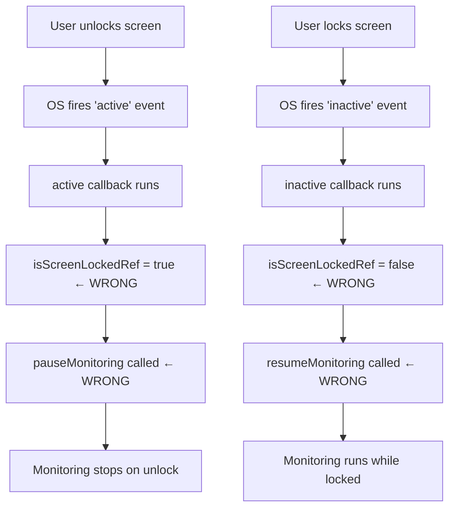
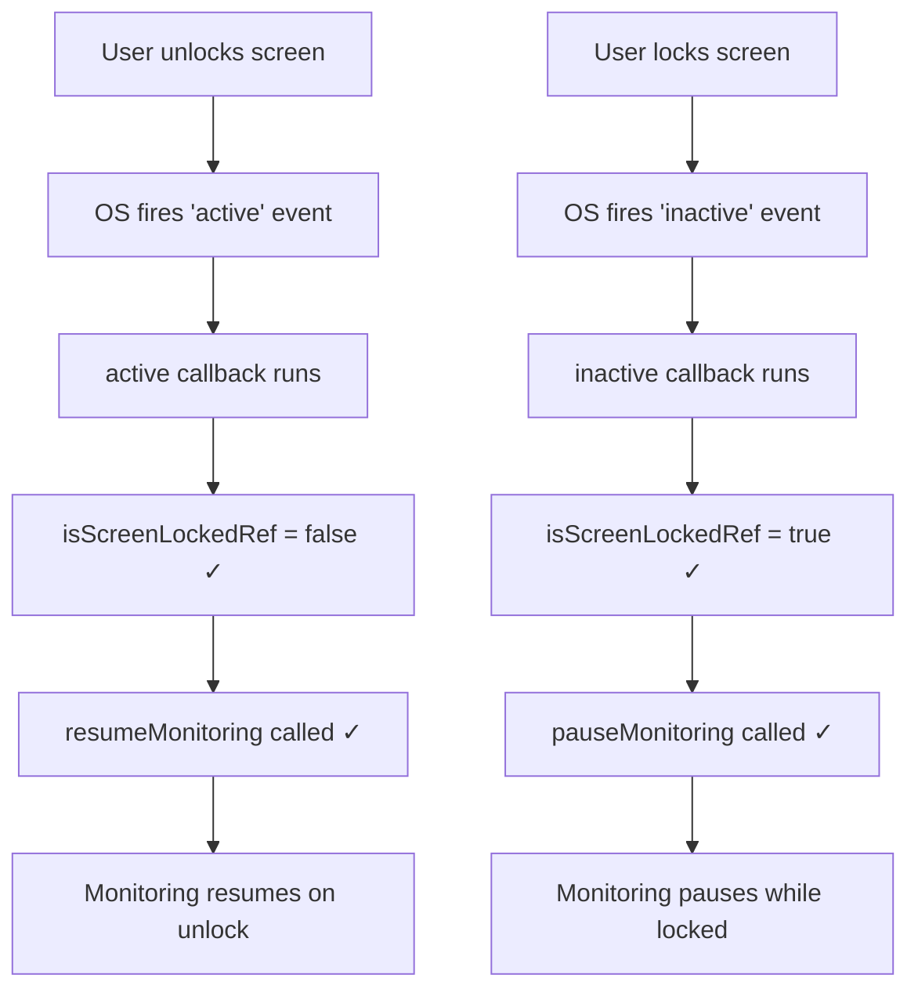
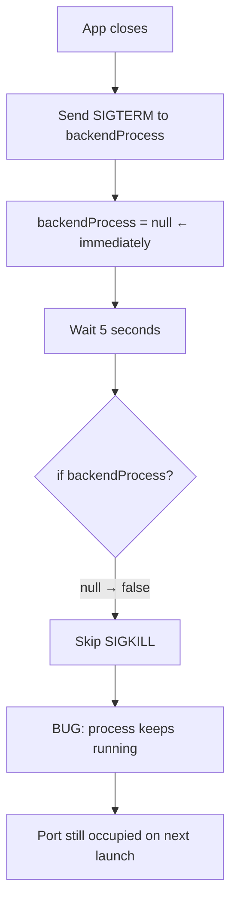
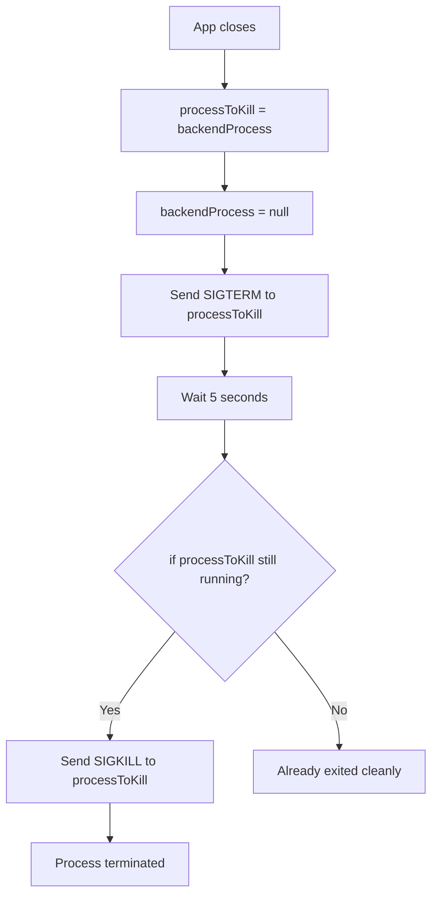

# Fix: Screen-Lock Callbacks Inverted + Backend Zombie Process

## Bug 1 — Screen Monitor Callbacks Swapped

### Summary
Screen monitoring paused when the user unlocked their machine and ran while the screen was locked — the exact opposite of intended behaviour.

### Root Cause
The `active` and `inactive` callback bodies in `useObservableTask` were swapped. `active` fires on screen **unlock** but called `pauseMonitoring()`. `inactive` fires on screen **lock** but called `resumeMonitoring()`.

### Bug Flow

### Fix Flow

---

## Bug 2 — Backend Process Not Killed on App Exit

### Summary
After closing the app, the Python backend process often stayed alive, occupying the port and causing "address already in use" errors on the next launch.

### Root Cause
`backendProcess` was set to `null` immediately after sending `SIGTERM`. The 5-second grace timeout checked `if (backendProcess)` — now always `null` — and skipped `SIGKILL`. The process was never force-killed.

### Bug Flow

### Fix Flow

## Files Changed

| File | Change |
|------|--------|
| `frontend/src/renderer/src/pages/screen-monitor/screen-monitor.tsx` | Swapped active/inactive callback bodies |
| `frontend/src/main/backend.ts` | Captured process ref before null; SIGKILL uses captured ref |

## PR Description

**Title:** `fix(monitor,backend): correct screen-lock state and ensure backend process cleanup`

**Bug 1:** The active and inactive callbacks in useObservableTask have swapped bodies. active fires on screen unlock but calls pauseMonitoring(); inactive fires on lock but calls resumeMonitoring(). The fix swaps the callback bodies to match the event semantics.

**Bug 2:** backendProcess is set to null right after SIGTERM, before the 5-second grace timeout fires. The timeout checks if (backendProcess) — now always null — and skips SIGKILL. The fix captures the reference before nulling so force-kill always executes if the process does not exit cleanly.
