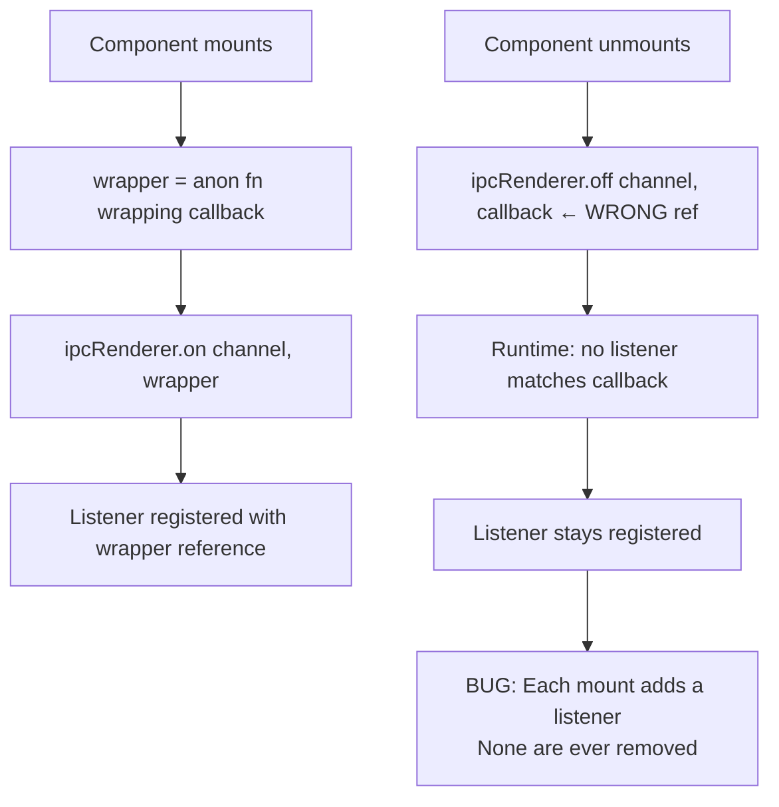
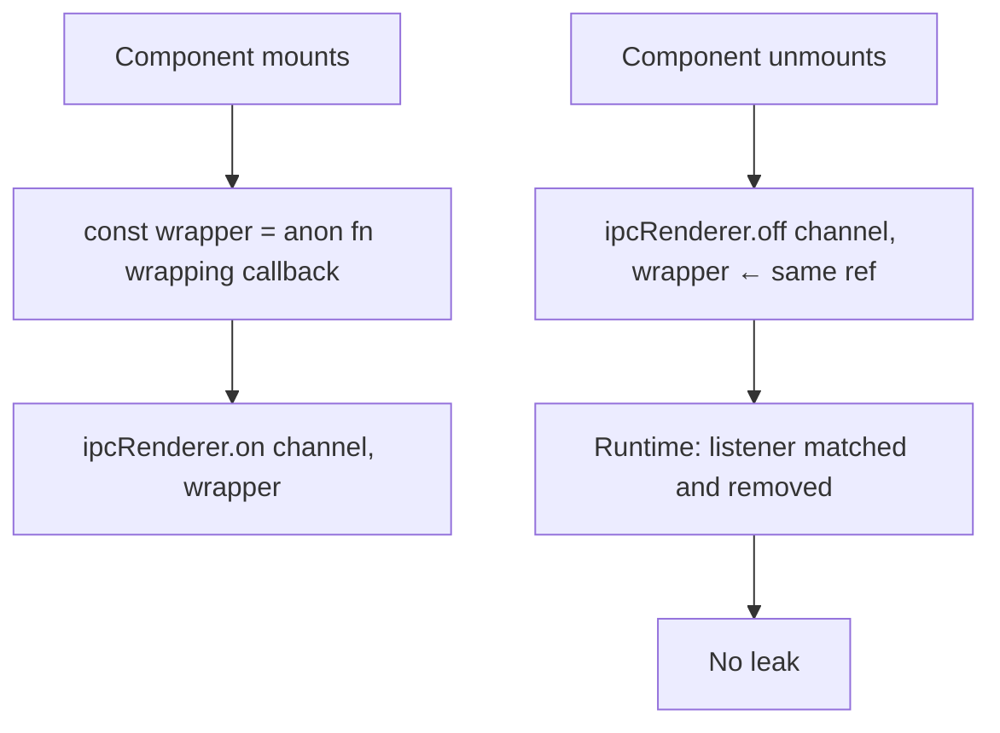
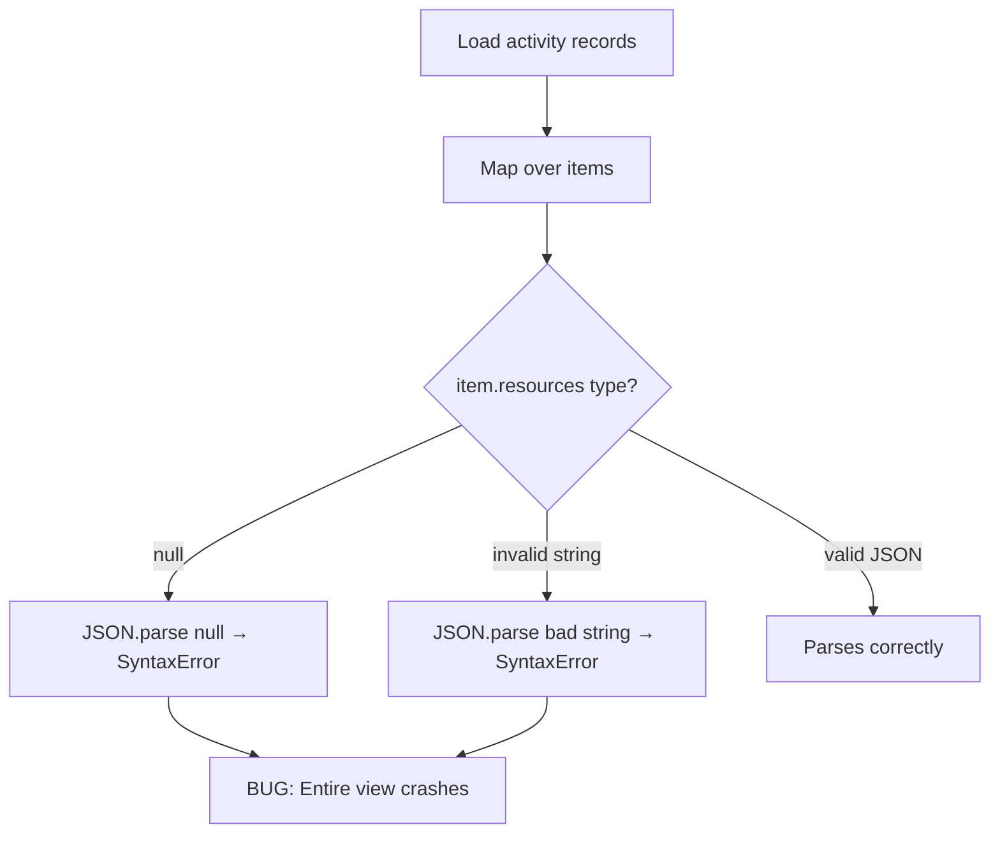
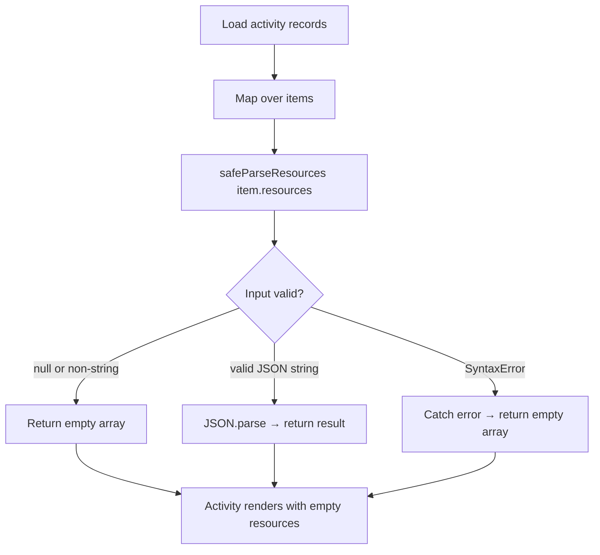

# Fix: IPC Listener Leak, JSON.parse Crash, Null Dereference

## Bug 1 — IPC Listeners Never Removed

### Summary
Every component mount registered a new IPC listener that was never removed, causing memory leaks and duplicate callback invocations.

### Root Cause
`ipcRenderer.on` registered an anonymous wrapper `(_, data) => callback(data)`, but `ipcRenderer.off` was called with the original `callback` reference. The runtime stores listeners by reference — since the wrapper and the callback are different objects, `.off` never matched and the listener persisted.

### Bug Flow

### Fix Flow

---

## Bug 2 — JSON.parse Crash on Null Resources

### Summary
The activity view crashed with `SyntaxError` when any activity record had null or malformed resources data.

### Root Cause
`JSON.parse(item.resources)` was called unconditionally. `item.resources` can be `null` (database default) or a non-JSON string, both of which cause `JSON.parse` to throw.

### Bug Flow

### Fix Flow

---

## Bug 3 — Null Dereference in GlobalEventService

### Summary
An unexpected API response shape caused an uncaught TypeError that stopped the event polling loop.

### Root Cause
`res.data && res.data.data.events` checked `res.data` but not `res.data.data`. When the server returned `{data: null}` or an unexpected shape, `res.data.data.events` threw `TypeError: Cannot read properties of null`.

### Fix
Changed to `res.data?.data?.events` with optional chaining.

## Files Changed

| File | Change |
|------|--------|
| `frontend/src/preload/server-push-api.tsx` | Store wrapper ref; pass to both on and off |
| `frontend/src/renderer/src/pages/screen-monitor/hooks/useActivityPolling.tsx` | Replace JSON.parse with safeParseResources helper |
| `frontend/src/renderer/src/services/GlobalEventService.ts` | Optional chaining on res.data?.data?.events |

## PR Description

**Title:** `fix(frontend): fix IPC listener leak, JSON.parse crash, and null dereference`

**Bug 1:** ipcRenderer.on registered an anonymous wrapper but ipcRenderer.off was called with the original callback reference — a mismatch the runtime cannot resolve. Listeners accumulated on every mount.

**Bug 2:** item.resources can be null or malformed. JSON.parse(null) threw SyntaxError and crashed the activity view. Added safeParseResources that returns [] for bad input.

**Bug 3:** res.data.data.events was accessed without checking res.data.data. Changed to optional chaining.
