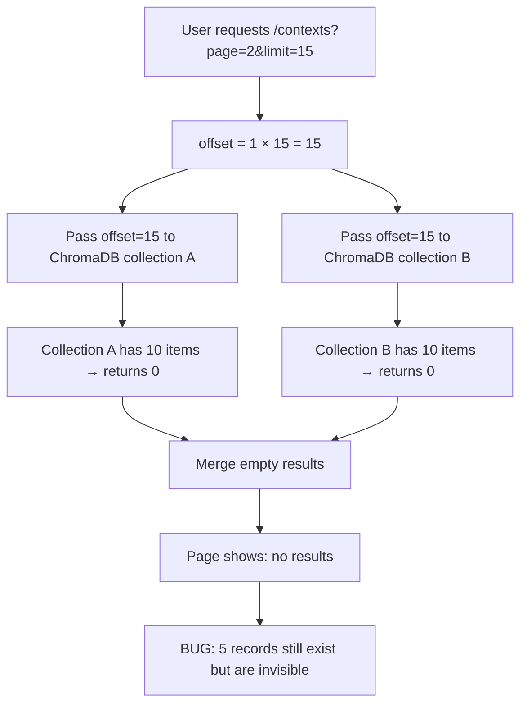

# Fix: Cross-Type Context Pagination

## Bug Summary

The `/contexts` page showed empty results on page 2 and beyond when browsing contexts of multiple types. Records existed but were never returned.

## Root Cause

`get_all_processed_contexts` applied the page offset independently to each ChromaDB collection before merging. With two 10-item collections and `offset=15`, both returned nothing — leaving 5 records stranded.

## Bug Flow



## Fix Flow

```mermaid
flowchart TD
    A[User requests /contexts?page=2&limit=15] --> B{Type filter set?}
    B -- Yes --> C[Pass offset to single collection\nPer-collection pagination is correct]
    B -- No --> D[Fetch ALL records with offset=0]
    D --> E[Merge all collections in Python]
    E --> F[Sort by create_time descending]
    F --> G[Slice: records[15:30]]
    G --> H[Return 5 items — correct!]
    C --> I[Return single-type page — unchanged]
```

## Files Changed

| File | Change |
|------|--------|
| `opencontext/server/routes/web.py` | Split route into single-type path (offset in DB) and multi-type path (fetch-all → merge → slice in Python) |

## PR Description

**Title:** `fix(web): correct cross-type pagination in /contexts view`

The `/contexts` page passes the global page offset directly into each ChromaDB collection query before merging results. With two collections each holding 10 items and `offset=15`, both collections return nothing — the page appears empty while five records still remain.

When no type filter is active, the route now fetches all matching records first, merges and sorts them in Python, then slices with the page offset. Single-type browsing is untouched.

**Fixes #377**
