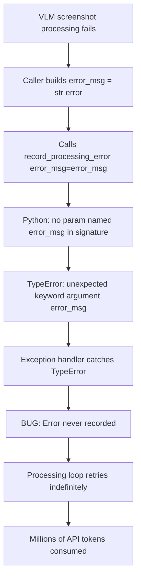
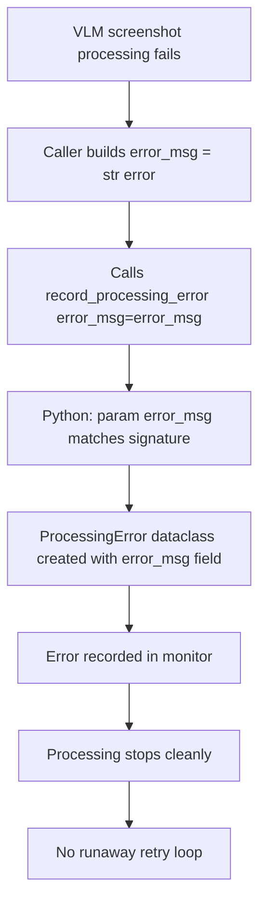

# Fix: record_processing_error Parameter Name Mismatch

## Bug Summary

VLM screenshot processing crashed whenever an error needed to be recorded, causing the "Failed during concurrent VLM processing" errors and triggering unbounded API retry loops that consumed millions of tokens.

## Root Cause

`record_processing_error()` was defined with `error_message` as the parameter name, but every caller used `error_msg` as their local variable name. Any keyword-argument call raised:

```
TypeError: record_processing_error() got an unexpected keyword argument 'error_msg'
```

The `ProcessingError` dataclass also used `error_message` as its field name, creating a consistent mismatch throughout the monitoring module.

## Bug Flow



## Fix Flow



## Changes Made

All occurrences of `error_message` renamed to `error_msg` within `monitor.py`:

| Location | Change |
|----------|--------|
| `ProcessingError` dataclass field | `error_message` → `error_msg` |
| `Monitor.record_processing_error()` parameter | `error_message` → `error_msg` |
| `ProcessingError(...)` constructor call | keyword updated |
| `get_processing_errors()` dict comprehension | `e.error_message` → `e.error_msg` |
| `get_recording_stats()` dict comprehension | `e.error_message` → `e.error_msg` |
| Module-level wrapper parameter | `error_message` → `error_msg` |

## File Changed

| File | Change |
|------|--------|
| `opencontext/monitoring/monitor.py` | 7 renames: parameter, dataclass field, and all read sites |

## PR Description

**Title:** `fix(monitor): align record_processing_error parameter name with callers`

**Fixes #220, #235**

record_processing_error() was defined with error_message as its parameter name, but every caller used error_msg. Any keyword-argument call raised TypeError, crashing VLM screenshot processing whenever an error needed to be recorded and triggering unbounded API retry loops.

Renamed the parameter and ProcessingError dataclass field to error_msg throughout monitor.py. Post-rename grep confirmed zero remaining references to the old name.
