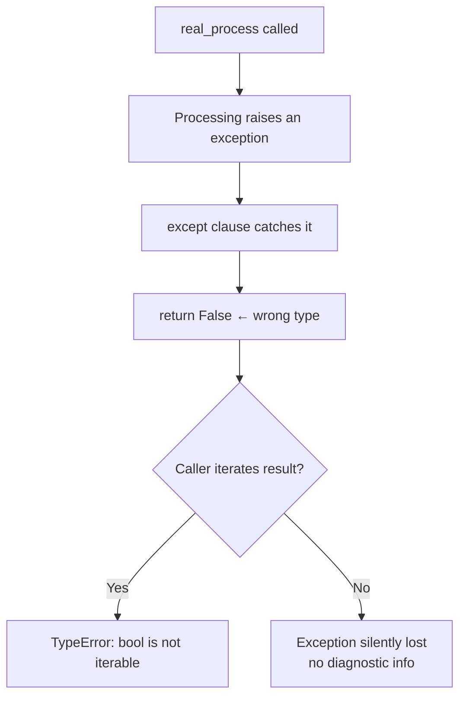
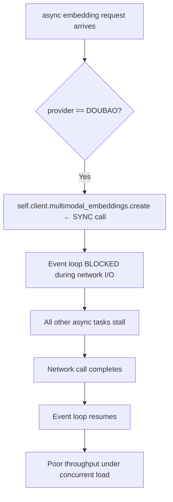
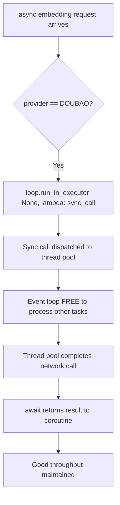

# Fix: Wrong Return Type and Blocking Async Embedding

## Bug 1 — `real_process()` Returns `False` on Error

### Summary
`DocumentProcessor.real_process()` silently swallowed exceptions and returned `False` instead of `[]`, violating its declared return type.

### Root Cause
The `except` clause had `return False`. The method is declared as `-> List[ProcessedContext]`. Any caller that iterates the result gets `TypeError: 'bool' object is not iterable`.

### Bug Flow



### Fix Flow

```mermaid
flowchart TD
    A[real_process called] --> B[Processing raises an exception]
    B --> C[except clause catches it]
    C --> D[return [] ← correct List type]
    D --> E[Caller checks: if processed_contexts → False]
    E --> F[Skips upsert cleanly]
    F --> G[Exception info logged, no crash]
```

---

## Bug 2 — Doubao Embeddings Block the Event Loop

### Summary
Every embedding request using the Doubao provider froze the asyncio event loop for the duration of the network call, degrading throughput for all concurrent async operations.

### Root Cause
`_request_embedding_async` is an `async def` method, but when `provider == DOUBAO`, it called the synchronous Ark SDK client (`self.client.multimodal_embeddings.create(...)`) directly. There is no async Ark client — `self.async_client` is explicitly set to `None` for the Doubao embedding provider.

### Bug Flow



### Fix Flow



## Files Changed

| File | Change |
|------|--------|
| `opencontext/context_processing/processor/document_processor.py` | `return False` → `return []` in except clause |
| `opencontext/llm/llm_client.py` | Wrapped sync Ark call with `run_in_executor`; added `import asyncio` |

## PR Description

**Title:** `fix(processor,llm): correct return type and move Doubao embeddings off the event loop`

document_processor.real_process() returned False on error instead of [], violating the List[ProcessedContext] return type and causing TypeError if any caller iterates the result.

Doubao embedding calls in _request_embedding_async used the synchronous Ark SDK client directly inside an async method, blocking the event loop for each network round-trip. Moved to run_in_executor so the thread pool handles the blocking I/O.
