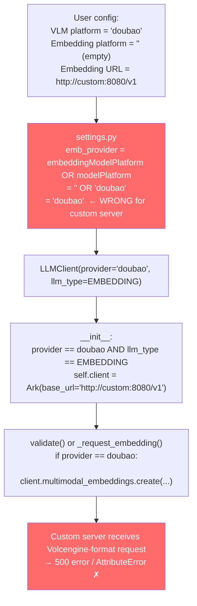
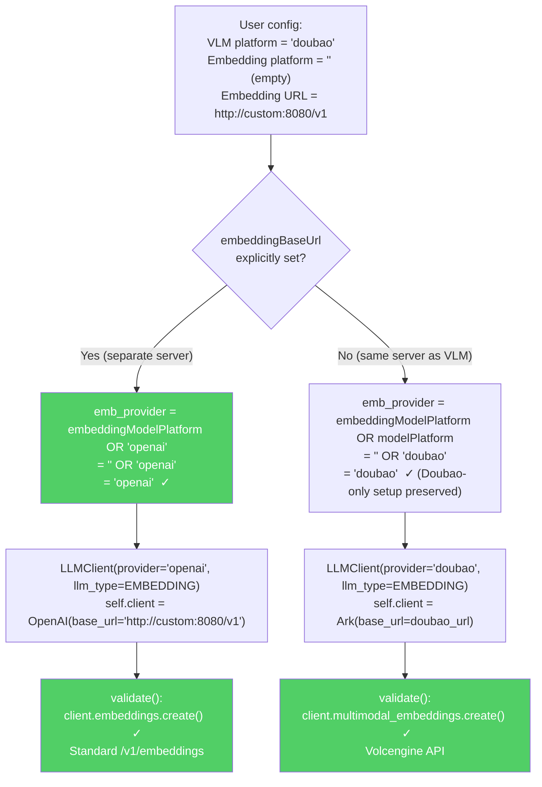

# PR: fix(settings): don't inherit VLM provider for separate embedding endpoint

## PR Description

**Title:** `fix(settings): don't inherit VLM provider for separate embedding endpoint`

**Target:** `volcengine/MineContext` ← `varun-projects:fix/embedding-provider-inheritance`

---

### What's happening

When a user configures a **separate embedding server** (a local OpenAI-compatible
endpoint like Ollama, LM Studio, or a custom server) alongside a Doubao VLM,
embedding validation always fails with:

```
AttributeError: 'OpenAI' object has no attribute 'multimodal_embeddings'
```

or a silent 500 from the embedding server.

### Root cause

In `opencontext/server/routes/settings.py`, the embedding provider is resolved as:

```python
emb_provider = cfg.embeddingModelPlatform or cfg.modelPlatform
```

When `embeddingModelPlatform` is not explicitly set (common — the UI may leave it
empty), this inherits the VLM platform. If the VLM platform is `"doubao"`, the
embedding `LLMClient` is initialised with the Ark SDK and calls
`multimodal_embeddings()` against the user's custom server, which only implements
the standard `/v1/embeddings` API.

### Fix

When `embeddingBaseUrl` is explicitly set to a different host, default the
embedding provider to `"openai"` instead of inheriting `modelPlatform`:

```python
if cfg.embeddingBaseUrl:
    emb_provider = cfg.embeddingModelPlatform or LLMProvider.OPENAI.value
else:
    emb_provider = cfg.embeddingModelPlatform or cfg.modelPlatform
```

Doubao-only setups (same service for both VLM and embedding, no separate URL)
are unchanged.

### Scope

One-file change in `opencontext/server/routes/settings.py`.

### Affected configurations

| Setup | Before | After |
|---|---|---|
| Doubao VLM + Doubao embedding (same URL) | ✅ works | ✅ works (unchanged) |
| Doubao VLM + custom embedding (separate URL) | ❌ `multimodal_embeddings` error | ✅ uses standard `/v1/embeddings` |
| Custom VLM + custom embedding (same URL) | ✅ works | ✅ works (unchanged) |
| Custom VLM + custom embedding (separate URL) | ✅ works | ✅ works (unchanged) |

Fixes #355, #346, #351

---

## Technical Documentation

### Background

MineContext supports two types of LLM backend:

| Provider | SDK used | Embedding API |
|---|---|---|
| `doubao` (Volcengine) | `Ark` (volcenginesdkarkruntime) | `client.multimodal_embeddings.create()` |
| `openai` / custom | `OpenAI` (openai-python) | `client.embeddings.create()` |

The wrong SDK + wrong API combination causes the reported `AttributeError`.

---

### The Bug — Provider Inheritance

#### Code path (before fix)



#### Why it happens

```
modelPlatform        = "doubao"    ← VLM uses Volcengine
embeddingModelPlatform = ""        ← user left this blank
embeddingBaseUrl     = "http://custom:8080/v1"

emb_provider = "" or "doubao"  →  "doubao"   ← BUG: inherits VLM platform
```

The empty-string `or` fallback silently overrides the user's intent: they
want a standard OpenAI-compatible embedding call, but get the Volcengine
`multimodal_embeddings` API instead.

---

### The Fix — URL-Aware Provider Resolution

#### Code path (after fix)



---

### Code Change

**File:** `opencontext/server/routes/settings.py`

#### Import change

```python
# Before
from opencontext.llm.llm_client import LLMClient, LLMType

# After
from opencontext.llm.llm_client import LLMClient, LLMProvider, LLMType
```

#### Provider resolution change

```python
# Before
emb_url = cfg.embeddingBaseUrl or cfg.baseUrl
emb_provider = cfg.embeddingModelPlatform or cfg.modelPlatform

# After
emb_url = cfg.embeddingBaseUrl or cfg.baseUrl
if cfg.embeddingBaseUrl:
    # Separate embedding service — don't inherit VLM provider.
    # Inheriting would select the Ark SDK and call multimodal_embeddings()
    # against a server that only implements /v1/embeddings.
    emb_provider = cfg.embeddingModelPlatform or LLMProvider.OPENAI.value
else:
    # Same service as VLM — inherit provider (preserves Doubao-only setups).
    emb_provider = cfg.embeddingModelPlatform or cfg.modelPlatform
```

---

### Design Decisions

| Decision | Rationale |
|---|---|
| Key on `embeddingBaseUrl` presence | A separate URL is the clearest signal the user intends a different service; keying on it avoids new UI fields |
| Default to `openai` not empty string | `openai` is the OpenAI Python SDK path, which all standard-compatible servers support |
| Preserve `or modelPlatform` when no separate URL | Doubao users who point both VLM and embedding at the same Ark endpoint should not need to change anything |
| Import `LLMProvider` | Avoids magic string `"openai"` and stays in sync if enum values change |

---

### Files Changed

| File | Change |
|---|---|
| `opencontext/server/routes/settings.py` | Import `LLMProvider`; make embedding provider resolution URL-aware |

No changes to `llm_client.py`, `global_embedding_client.py`, or any storage layer.
